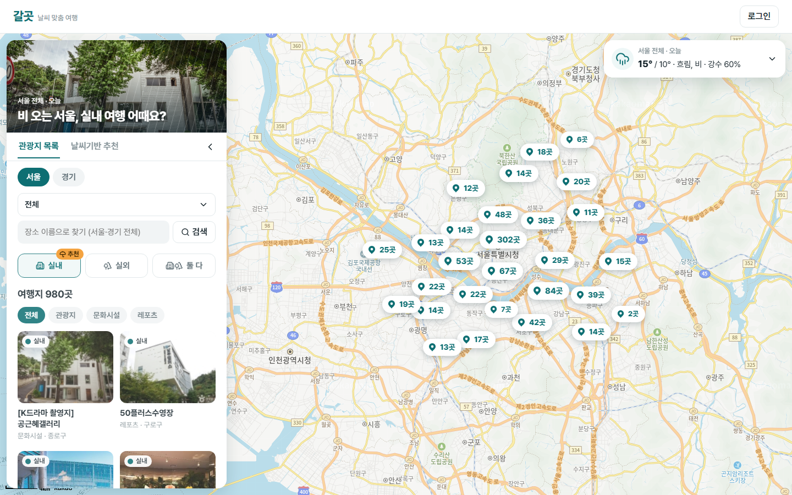
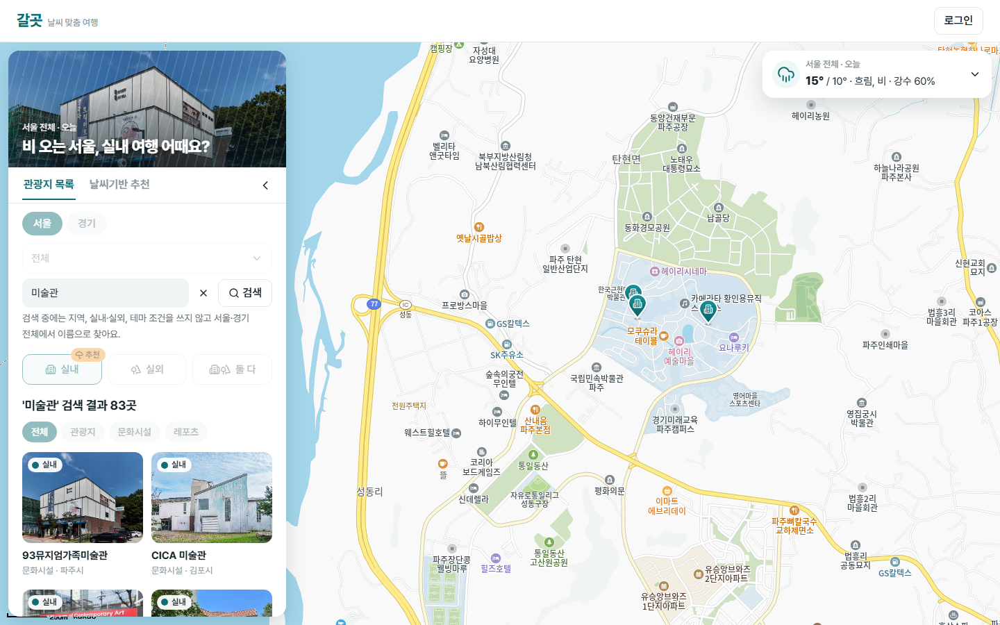
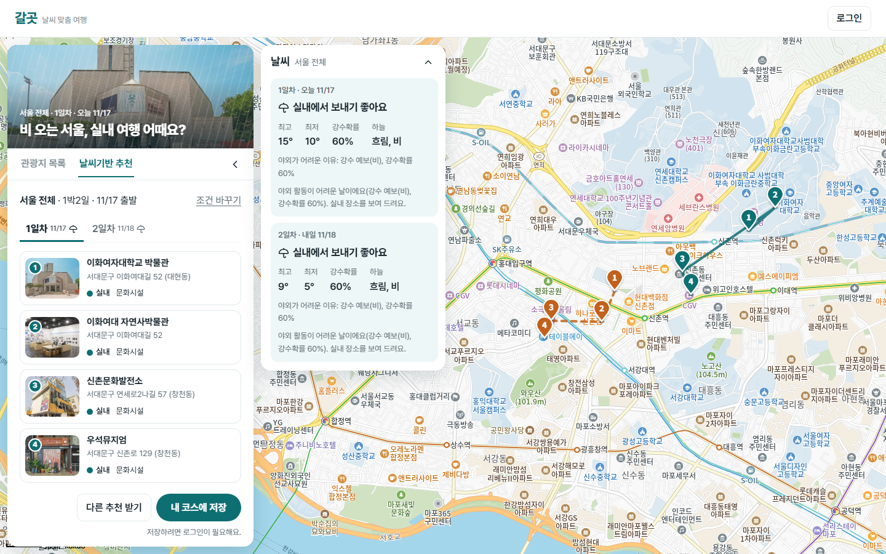

# 갈곳 — 날씨 맞춤 여행 코스 추천

오늘 날씨에 맞춰 서울·경기의 갈 만한 곳을 추천해 주는 웹 서비스입니다.
비가 오면 실내, 맑으면 야외 장소를 중심으로 코스를 보여 줍니다.

- **배포 주소**: https://galgot.duckdns.org
- **테스트 계정**: `galgot-test@galgot.test` / `Gt76768e671846bc7ab9103` (화면 오른쪽 위 [로그인] → 이메일 로그인)

| 메인 | 장소 목록(검색) | 지도(날씨기반 코스) |
| --- | --- | --- |
|  |  |  |

## 주요 기능

- **날씨 맞춤 추천**: 기상청 단기예보로 지역별 날씨를 확인하고, 실내/야외로 분류한 장소를 날씨에 맞게 추천합니다. 비·눈이 오거나 강수확률 60% 이상, 최고 33도 이상, 최저 -10도 이하이면 야외 활동이 어려운 날로 보고 실내 장소를 먼저 보여 줍니다.
- **날씨기반 코스 추천**: 출발일과 일정(당일치기~2박3일)을 고르면 일차마다 그날 날씨로 판정해 하루 4곳을 가까운 순서로 묶어 줍니다. 지도에 일차별 번호와 동선을 표시합니다.
- **지역별 장소 조회와 검색**: 서울은 구(25개), 경기는 시·군(31개) 단위로 조회하고, 장소 이름으로 서울·경기 전체에서 검색할 수 있습니다.
- **지도와 장소 상세**: 카카오 지도에 장소 마커를 표시하고, 장소를 고르면 사진, 이용시간, 쉬는 날, 요금, 주차, 소개를 보여 줍니다.
- **내 코스**: 추천 코스나 장소를 내 코스에 저장하고, 마이페이지에서 장소 순서와 일차를 끌어서 바꿀 수 있습니다. 공유 링크를 보내면 로그인하지 않은 사람도 코스를 볼 수 있습니다.
- **회원가입·로그인**: 이메일 회원가입·로그인과 카카오 로그인(세션 방식), 닉네임 변경, 회원 탈퇴.

## 기술 스택

| 구분 | 기술 |
| --- | --- |
| Frontend | React, TypeScript, Vite, React Router, @dnd-kit(끌어서 순서 바꾸기) |
| Backend | Java 17, Spring Boot, Spring Security(세션, OAuth2), Spring Data JPA, Gradle |
| Database | MySQL, Flyway(DB 마이그레이션) |
| 외부 API | 한국관광공사 TourAPI, 기상청 단기예보 API, 카카오 지도 API, 카카오 로그인 |
| 배포 | AWS EC2, Docker, Docker Compose, Caddy(HTTPS), DuckDNS |

## 구조

```
galgot/
├── src/            # Spring Boot 백엔드
├── galgot-web/     # React 프론트엔드
├── deploy/         # 배포 설정(Caddy)
├── docs/           # 문서(배포 방법, 화면 캡처)
├── Dockerfile
└── docker-compose.yml   # DB·서버·화면을 한 번에 실행
```

```
브라우저 ─ Caddy(HTTPS) ─┬─ React 화면(정적 파일)
                         └─ /api → Spring Boot ─┬─ MySQL
                                                ├─ TourAPI(장소)
                                                ├─ 기상청(날씨)
                                                └─ 카카오(로그인)
```

## 고민하고 해결한 점

### 1. 장소를 실내/야외로 나누기
- **문제**: TourAPI 장소 데이터에는 실내인지 야외인지 알려 주는 값이 없습니다.
- **해결**: TourAPI가 주는 분류 코드(대·중·소분류)와 장소 이름에 들어간 단어(박물관, 미술관, 둘레길 등)로 규칙을 만들어 DB 표(`env_rules`)에 넣었습니다. 규칙이 여러 개 걸리면 더 구체적인 규칙이 이기도록 우선순위를 두었습니다(장소 직접 지정 > 소분류 > 이름 단어 > 중분류 > 대분류). 우선순위가 같으면 실내를 고릅니다. 비 오는 날 야외 장소를 추천하는 실수가 가장 나쁘다고 봤기 때문입니다. 어떤 규칙에도 안 걸리면 "둘 다"로 둡니다.
- **결과**: 서울·경기 4,343곳을 실내 1,056곳, 야외 2,028곳, 둘 다 1,259곳으로 나눴습니다. 판단 로직은 DB나 네트워크 없이 도는 클래스(`EnvClassifier`)로 분리해 단위 테스트로 확인했고, 규칙을 바꿀 때는 코드 대신 DB 규칙만 고치면 됩니다.

### 2. 공공 API 데이터를 DB에 모아 두기
- **문제**: 화면을 열 때마다 TourAPI와 기상청을 부르면 느리고, 공공 API는 하루 호출 횟수에 제한이 있습니다. 또 TourAPI만으로는 "가평군의 실내 장소"처럼 우리 기준으로 거를 수 없습니다.
- **해결**: 서울·경기의 관광지·문화시설·레포츠 장소를 미리 수집해 MySQL에 저장하고, 화면은 우리 서버 API로 조회합니다. 장소 ID 기준으로 덮어쓰기 때문에 다시 수집해도 중복이 생기지 않고, 한 번에 부르는 횟수에 상한(300번)을 두었습니다. 장소 상세 정보는 처음 열 때만 받아 30일 동안 저장하고, 날씨는 지역·날짜별로 저장해 3시간이 지났을 때만 다시 받습니다. 기상청 호출이 실패하면 저장해 둔 이전 값을 보여 줍니다.

### 3. 서버 한 대에 무료로 배포하기
- **문제**: 비용 없이 HTTPS 주소로 서비스해야 하고, 로그인은 세션 쿠키 방식이라 화면과 API 주소가 다르면 브라우저가 쿠키를 막을 수 있습니다.
- **해결**: AWS EC2 무료 플랜 서버 한 대에 Docker Compose로 DB·서버·화면을 함께 띄웠습니다. 앞단의 Caddy가 HTTPS 인증서를 자동으로 받고, 화면 파일을 내보내면서 `/api` 요청만 Spring Boot로 넘깁니다. 화면과 API가 같은 주소라 쿠키 설정을 바꾸지 않아도 됐습니다. 주소는 DuckDNS 무료 주소를 쓰고, 키와 비밀번호는 서버의 `.env` 파일로만 넣어 저장소에 올라가지 않게 했습니다. 메모리 2GB 서버라 Java와 MySQL의 메모리 사용량에 상한을 두었습니다.

## 로컬 실행

필요한 키: 카카오(REST API 키, Client Secret, JavaScript 키), 공공데이터포털(TourAPI, 기상청) 서비스 키

**개발 모드**

```bash
# 1. 백엔드: MySQL에 galgot DB를 만든 뒤 환경 변수와 함께 실행 (Flyway가 표를 만듦)
#    DB_URL, DB_USERNAME, DB_PASSWORD, KAKAO_REST_API_KEY, KAKAO_CLIENT_SECRET,
#    TOURAPI_SERVICE_KEY, KMA_SERVICE_KEY
#    처음 한 번은 COLLECT_RUN_ON_STARTUP=true, CLASSIFY_RUN_ON_STARTUP=true 로 장소 수집과 분류
./gradlew bootRun

# 2. 프론트엔드: galgot-web/.env.local 에 VITE_KAKAO_MAP_KEY=카카오 JavaScript 키
cd galgot-web
npm install
npm run dev    # http://localhost:5173
```

**Docker로 한 번에 실행**

```bash
cp .env.example .env   # 주소와 키 입력
docker compose up -d --build
```

배포 방법은 [docs/deploy.md](docs/deploy.md)에 정리했습니다.
